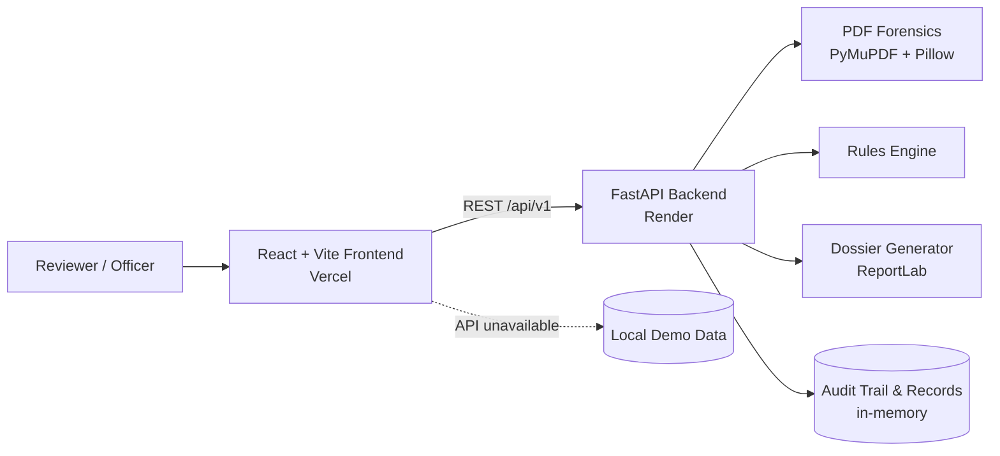

<div align="center">

# 🛡️ PRAGYAN-AICTE

### AI-Powered Application Validation, Document Authentication & Regulatory Compliance Verification

*Smarter scrutiny for technical institution applications, built for the AICTE Regulation Bureau.*

<br/>


</div>

---

> [!IMPORTANT]
> **Prototype & decision-support tool.** Automated findings, authority statuses, rules, benchmarks and sample records are **illustrative only**. They are **not** official AICTE verification or regulatory decisions. Statutory scrutiny, inspections, and final decisions remain with authorized officials and committees.

## 📑 Table of Contents

- [About the Project](#-about-the-project)
- [Project Information](#-project-information)
- [Key Features](#-key-features)
- [System Architecture](#-system-architecture)
- [Tech Stack](#-tech-stack)
- [Repository Structure](#-repository-structure)
- [Getting Started](#-getting-started)
- [Deployment](#-deployment)
- [API Overview](#-api-overview)
- [Testing](#-testing)
- [Limitations & Security Notes](#-limitations--security-notes)
- [License](#-license)

---

## 🎯 About the Project

Scrutinizing applications from technical institutions is document-heavy and time-consuming. Reviewers must cross-check certificates, verify issuing authorities, spot inconsistencies and map everything against regulatory norms.

**PRAGYAN-AICTE** assists reviewers by automating the first pass:

| Challenge | How PRAGYAN helps |
|---|---|
| Manual document checking | Preliminary PDF scrutiny with metadata checks and extracted facts |
| Hidden discrepancies | Automated discrepancy detection, alerts and deficiency tracking |
| Authority verification | Illustrative issuing-authority verification statuses |
| Compliance mapping | Configurable regulatory rules engine |
| Accountability | Reviewer actions logged in a full audit trail |

## 🏛️ Project Information

| | |
|---|---|
| **Organization** | All India Council for Technical Education (AICTE) |
| **Department** | Regulation Bureau |
| **SIH Problem Statement** | `26261`: AI-Powered Application Validation, Document Authentication and Regulatory Compliance Verification |
| **Theme** | Smart Automation |

## ✨ Key Features

- 📊 **Overview Dashboard**: application, document, deficiency and audit summaries at a glance.
- 📥 **Application Queue**: search, status filters and detailed scrutiny views.
- 📄 **Document Scrutiny**: upload documents for preliminary PDF analysis, including metadata checks and fact extraction.
- 🏷️ **Authority Verification**: illustrative issuing-authority statuses.
- ⚖️ **Compliance Rules Engine**: configurable sample regulatory rules.
- 🚨 **Alerts & Deficiencies**: flagged issues with reviewer actions.
- 🧾 **Audit Trail**: traceable record of reviewer activity.
- 📁 **Dossier Export**: generate PDF dossiers for an application.
- 📈 **Evaluation Benchmarks**: benchmark endpoints for measuring performance.
- 🧊 **Immersive 3D Experience**: scroll-driven document verification visuals with a **2D fallback**.
- 🔌 **Offline-friendly Demo Mode**: local demo data is used when the API is not configured or unavailable.

> The app ships with sample/demo records. Authority statuses, rules, benchmarks and findings must **not** be represented as live official determinations.

## 🧩 System Architecture



## 🛠️ Tech Stack

<table>
<tr>
<td valign="top" width="50%">

### Frontend
- **React** with **Vite**
- **React Three Fiber** + **Three.js**
- **GSAP** for scroll-driven animation
- **React Router**

</td>
<td valign="top" width="50%">

### Backend
- **Python** with **FastAPI** and **Uvicorn**
- **PyMuPDF** and **Pillow** for PDF/image analysis
- **ReportLab** for PDF dossier generation

</td>
</tr>
</table>

## 📂 Repository Structure

The frontend and backend live in **separate Git branches**:

| Branch | Contains | Deployed to |
|---|---|---|
| `Frontend` | React app under `Frontend/` | Vercel |
| `Backend` | FastAPI app under `Backend/` | Render |

<details>
<summary><b>Frontend branch layout</b></summary>

```text
Frontend/
├── package.json
├── package-lock.json
├── index.html
├── vite.config.js
├── public/
└── src/
```

</details>

<details>
<summary><b>Backend branch layout</b></summary>

```text
Backend/
├── main.py
├── forensic.py
├── rules.py
├── dossier_generator.py
├── uploads/
└── requirements.txt
```

</details>

> [!NOTE]
> Make sure `Backend/requirements.txt` is committed to the `Backend` branch before deploying the API.

## 🚀 Getting Started

### Frontend

**Prerequisites:** Node.js and npm.

```bash
git checkout Frontend
cd Frontend
npm install
npm run dev
```

Open the URL printed by Vite (normally <http://localhost:5173>).

Production build and preview:

```bash
npm run build
npm run preview
```

### Backend

**Prerequisites:** Python 3.10+ and pip.

```bash
git checkout Backend
cd Backend
python -m venv .venv
```

Activate the virtual environment:

```powershell
# Windows PowerShell
.\.venv\Scripts\Activate.ps1
```

```bash
# macOS / Linux
source .venv/bin/activate
```

Install dependencies and start the API:

```bash
pip install -r requirements.txt
uvicorn main:app --reload --host 0.0.0.0 --port 8000
```

| Local URL | Purpose |
|---|---|
| <http://127.0.0.1:8000/api/v1/health> | Health check |
| <http://127.0.0.1:8000/docs> | Interactive API docs (Swagger UI) |

The frontend uses `http://127.0.0.1:8000` by default during local development.

## ☁️ Deployment

### Backend → Render

Create a **Web Service** from this GitHub repository:

| Setting | Value |
|---|---|
| Branch | `Backend` |
| Root Directory | `Backend` |
| Runtime | Python |
| Build Command | `pip install -r requirements.txt` |
| Start Command | `uvicorn main:app --host 0.0.0.0 --port $PORT` |

No environment variables are required for the current demo backend. After deploying, verify:

```text
https://YOUR-RENDER-SERVICE.onrender.com/api/v1/health
https://YOUR-RENDER-SERVICE.onrender.com/docs
```

> [!TIP]
> Render free services may sleep when idle, so the first request after inactivity can take longer.

### Frontend → Vercel

Import the repository into Vercel:

| Setting | Value |
|---|---|
| Production Branch | `Frontend` |
| Root Directory | `Frontend` |
| Framework Preset | Vite |
| Install Command | `npm install` |
| Build Command | `npm run build` |
| Output Directory | `dist` |

**Connect to the deployed backend** by adding this environment variable in Vercel (Production, and Preview if needed):

```text
VITE_API_BASE_URL=https://YOUR-RENDER-SERVICE.onrender.com
```

Use the Render base URL only. Do **not** add `/api/v1/health` or a trailing slash. Redeploy the frontend after adding or changing the variable.

The frontend must read this variable when building its API base URL, for example in `Frontend/src/services/api.js`:

```js
const BACKEND_BASE_URL = (
  import.meta.env.VITE_API_BASE_URL ||
  (import.meta.env.DEV ? 'http://127.0.0.1:8000' : '')
).replace(/\/$/, '');
```

Commit and push this change to the `Frontend` branch before expecting Vercel to use the variable. If no production API URL is configured, the frontend falls back to demo data where supported; backend-only actions will be unavailable.

## 🔌 API Overview

All routes are prefixed with `/api/v1`.

| Group | Endpoints |
|---|---|
| **Health** | `GET /health` |
| **Applications** | `GET /applications` · `GET /applications/{app_id}` |
| **Rules** | `GET /rules` · `PUT /rules/{rule_id}` |
| **Scrutiny** | `POST /scrutiny/verify-files` · `POST /scrutiny/record-action` · `GET /scrutiny/export-dossier/{app_id}` |
| **Audit** | `GET /audit-trail` |
| **Metrics** | `GET /metrics/evaluation-benchmarks` |
| **Other** | Faculty registry, ghost-alert, notification and demo authentication routes |

For complete, current request/response schemas, open the deployed `/docs` page.

## 🧪 Testing

The backend includes a basic API verification script. From the `Backend` directory, install the runtime dependencies (plus the test client if needed) and run:

```bash
python test_backend.py
```

## ⚠️ Limitations & Security Notes

This is a **demonstration prototype**. Before any real-world use:

- **In-memory state:** application records, rule changes and audit events reset on service restart and are not shared across instances.
- **Ephemeral storage:** uploaded files and generated artifacts use local disk, which may be lost on redeploy/restart. Use durable database/object storage.
- **CORS:** restrict backend CORS to the deployed frontend origin. Broad development settings are not a production policy.
- **Authentication:** protect upload and reviewer endpoints with proper authentication and authorization.
- **Data privacy:** do **not** upload sensitive, confidential or personal documents to this demo deployment.

## 📜 License

No license is currently specified for this repository. Unless a license is added, reuse and redistribution are not granted.

---

<div align="center">

**Built for Smart India Hackathon · Problem Statement 26261**

*Decision support for officials, not a replacement for them.*

</div>
